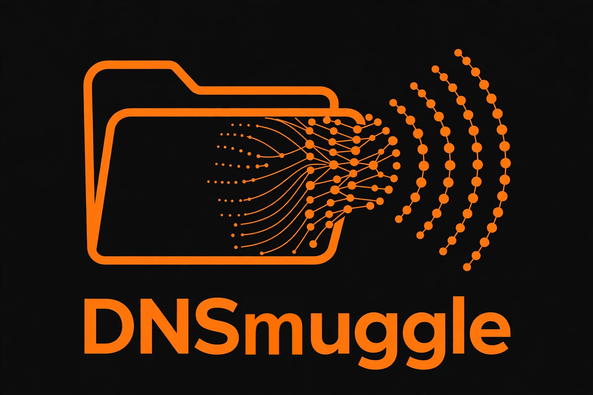
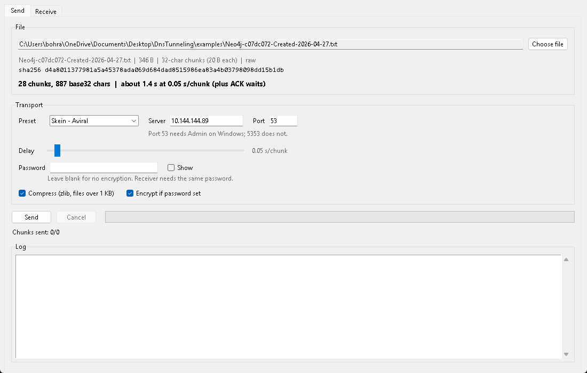
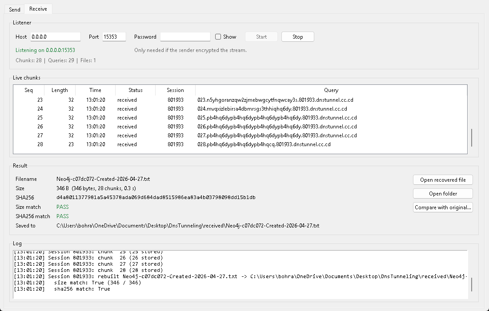

<p align="center">
  
</p>

# DNSmuggle

Smuggle a file out using only DNS queries — then watch it happen, verify it,
catch it with a detector, and print a report. A lab demo of DNS tunnelling:
the encoder turns a file into DNS questions, a decoder on your own server
rebuilds it from those questions.

> **Lab only. Test only with your own files, from your own machines, to
> a server you own.** Never point this at someone else's machine, a real
> network you do not control, a college or work network, or a public
> site without permission. The "victim" in every demo here is your own
> host: you create the test file and start the encoder yourself. There
> is no infiltration step in this project.

## One window, the whole demo

A Tkinter desktop app with five tabs: **Send**, **Receive**, **History**,
**Detector**, **Settings**. No command line needed for the demo.

## How to use, with screenshots



### 1. Start the receiver first

**Receive** tab → Host `127.0.0.1`, Port `5353` → **Start**. The status
line turns green and the chunk table starts empty. Leave this window running.
If port 5353 is occupied, choose another free UDP port.

### 2. Send a file

**Send** tab → **Choose file** → Preset `Loopback` → **Send**. If you chose
a different receiver port, enter it in the Send tab as well. For another
machine, select `Custom` and enter your decoder's address and port.
Select a Base32 chunk size from 16–63 characters (32 by default) and a delay
(0.01 seconds by default). The preview shows the actual chunk count and
estimated time; the log shows ACK counts for each window.

### 3. Check the result

The Receive tab fills in Filename, Size, SHA256 and both verdicts:
`Size match PASS` and `SHA256 match PASS`. The file lands in `received/`,
never overwriting: a second copy of the same name becomes `name (1).ext`.
Use **Compare with original...** to diff SHA256 against the source file.



> The screenshots show the earlier interface. The receive screenshot uses a
> temporary loopback port and folder rather than the defaults above.

## Install and run

Python **3.11+**. Windows first, Linux second.

| Requirement | Why |
|---|---|
| `cryptography` | Fernet (AES-128-CBC + HMAC-SHA256) and PBKDF2 for password encryption |
| Tkinter | the GUI; ships with the python.org Windows/macOS installers |
| `reportlab` *(optional)* | PDF reports; without it reports are written as `.txt` |
| `pytest` *(dev)* | the test suite |

```bash
# install the one runtime dependency
python -m pip install -r requirements.txt

# Windows
python -m app.main

# Linux (install Tkinter first: sudo apt install python3-tk)
python3 -m app.main
```

Optional, installs the `dnsmuggle` command (plus `dnstunnel-app` as an alias
from before the rename):

```bash
python -m pip install .
dnsmuggle
```

Port **53 needs Admin/sudo**. Port **5353** does not — but on Windows both
can already be taken (Internet Connection Sharing holds 53, mDNS/Bonjour
holds 5353); the status line says which, pick a free port instead.

## How it works

```
your file ──> encoder ── DNS queries ──> decoder ──> recovered file
                │  001.<chunk>.<session>.dnstunnel.cc.cd
                │  002.<chunk>.<session>.dnstunnel.cc.cd
                │  END.<session>.dnstunnel.cc.cd
```

1. Read the file as bytes, not text, so text, PNGs and zips all work.
2. Compress with zlib level 6 when the payload is over 1 KB (flagged in the
   header), then encrypt with Fernet when a password is set (also flagged).
3. Build the stream: header JSON + `\n` + the processed bytes. `size` and
   `sha256` describe the **original** file, so verification is end to end.
4. Base32-encode the stream and cut it into chunks of 16–63 characters
   (32 by default), numbered `001, 002, ...`. Each query carries one chunk.
5. Send up to 10 queries before collecting their individual matching-QID
   ACKs. Retry only missing chunks on timeout (max 3 attempts, 2.0 s each).
6. Send one `END` query. The decoder sorts chunks **numerically**, decodes
   them, reverses encrypt/decompress, and checks size and SHA256 against the
   header.

Hand-built DNS packets only: `socket` + `struct`, no DNS library anywhere.

### Real chunk counts

The header carries the filename, a 64-character hex SHA256, flags and the
chunk count, so a small file costs more queries than its size suggests.
These counts use the default 32-character chunk size.

| File | Chunks |
|---|---|
| 15 B | 10 |
| 346 B (`examples/Neo4j-...txt`) | 28 |
| 1 KB, uncompressed | 61 |
| 4 KB of `A`, compressed | 11 |

The GUI previews this before you send, from the real stream, never a guess.

## Project structure

```
DNSMuggle/
├── app/
│   ├── main.py                 # entry: python -m app.main / dnsmuggle
│   ├── protocol.py             # packets, chunking, ACK/retry/END, Receiver
│   ├── crypto.py               # Fernet + PBKDF2, XOR+HMAC fallback
│   ├── compress.py             # zlib layer above 1 KB
│   ├── detector.py             # length, entropy, rate rules (tap on Receiver)
│   ├── history.py              # SQLite history.db, transfers table
│   ├── report.py               # text/PDF reports into reports/
│   ├── config.py               # presets, defaults, config.json load/save
│   ├── utils.py                # sha256, size/time formatting, dedup paths
│   ├── assets/                 # dnsmuggle-logo.png, dnsmuggle-icon.png/.ico
│   └── gui/                    # main window + five tabs
├── encoder.py                  # CLI wrapper over app.protocol
├── decoder.py                  # CLI wrapper over app.protocol
├── dns_topo.py                 # Mininet topology: h1, h2, s1
├── tests/                      # pytest suite
├── examples/
│   ├── secret.txt              # "Meet at 5"
│   └── Neo4j-c07dc072-Created-2026-04-27.txt  # 346 B, 28 chunks
├── docs/
│   ├── PROTOCOL.md             # packets, stream, layers, limits
│   ├── DEMO_SKEIN.md           # Skein mesh demo script
│   ├── PORT_FORWARDING_TEST.md # public relay test
│   ├── TWO_LAPTOP_SETUP.md     # same-Wi-Fi test
│   ├── VM_DEPLOY.md            # permanent decoder VM
│   └── screenshots/            # logo + Send/Receive screenshots
├── requirements.txt
├── pyproject.toml              # pip install . -> "dnsmuggle" command
└── README.md
```

## Command line (still works)

The GUI is a client of the same library; the CLIs are thin wrappers over it.

```bash
# Terminal 1
python decoder.py --host 127.0.0.1 --port 15353

# Terminal 2
python encoder.py examples/secret.txt --server 127.0.0.1 --port 15353 --delay 0.01 --chunk-size 32
```

Both accept `--password` (encrypt/decrypt), `--domain`, and `--no-compress`.
The decoder writes `recovered_<filename>`; the GUI writes into `received/`.

## Tests

```bash
python -m pytest tests/ -v
```

The suite covers protocol and chunking, selective ACK retries, UDP loopback,
encryption, detection and reports.


## Tabs

- **Send** — file, real chunk/time estimate, 16–63-character chunk-size
  slider, 10-chunk ACK windows, delay slider, optional password, live log,
  progress with chunks/sec and ETA, Cancel. The log retains the newest 4,000
  lines; labels over 40 characters trigger the detector's length rule.
- **Receive** — host/port, start/stop, live chunk table with the actual
  queries, size/SHA256 verdicts, open file/folder, compare with original.
  The log also retains the newest 4,000 lines.
- **History** — every send and receive recorded in `history.db` (SQLite):
  date, filename, size, session, server, mode, chunks, result, time taken.
  Refresh, clear, export CSV, generate a report.
- **Detector** — a passive tap on the **Receive tab's** listener: one socket,
  no second bind, so it can watch the same port as the receiver. Length,
  entropy and rate rules, queries-per-second chart on a Canvas, alerts list,
  and a "Possible DNS tunnelling detected" banner when two or more rules fire
  within 60 seconds. **Start monitoring** starts that shared listener if it
  is not running; **Stop monitoring** only detaches, the receiver keeps
  listening. Two self-tests: real encoder chunks get flagged, ordinary DNS
  names pass.
- **Settings** — defaults, transport mode, receiver folder, history path,
  and About (with logo). Domain mode stays disabled behind a warning until
  the public relay test is verified.

## Known limits

- **Encryption only when a password is set.** Left blank, chunks are Base32
  and anyone on the path can read them. With a password: Fernet + PBKDF2
  (200 000 iterations, random salt per message).
- At the default chunk size each query carries approximately 20 stream bytes;
  changing the size trades fewer queries for longer, more detectable labels.
- UDP only, no resume: a decoder restart loses the in-memory session.
- DNS-over-HTTPS would bypass this channel entirely.
- Easy to flag with length, entropy and rate heuristics at high speed — which
  is exactly what the Detector tab demonstrates.
- The detector sees exactly what reaches the receiver's socket: tunnel
  queries plus any ordinary DNS sent to that host and port. It is not a
  promiscuous sniffer and cannot see traffic addressed elsewhere on the
  network.

## Safety

Lab only: your own machines, your own files, your own decoder. There is no
scanning, no exfiltration helper, and no target list.

## License

MIT. See `LICENSE`.
